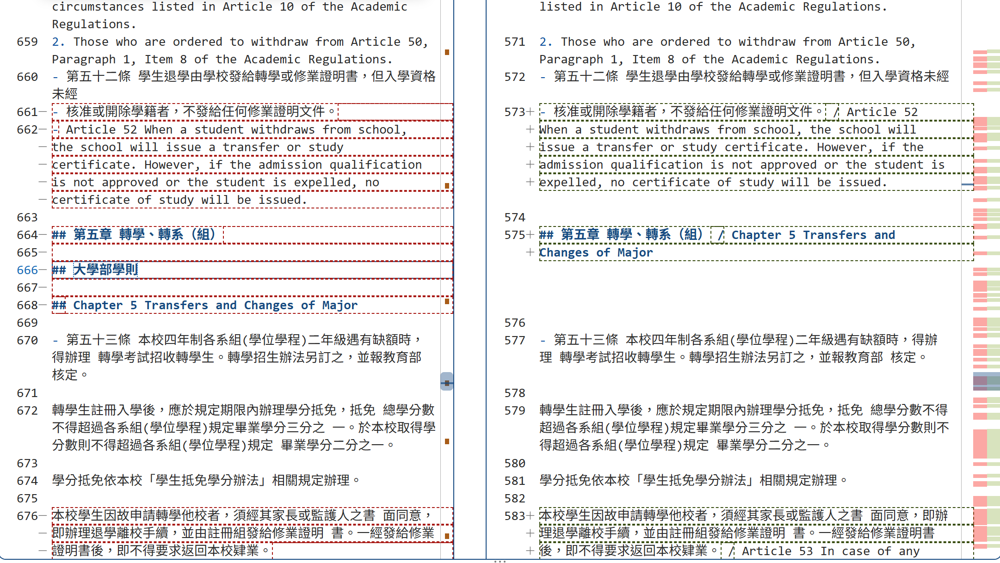
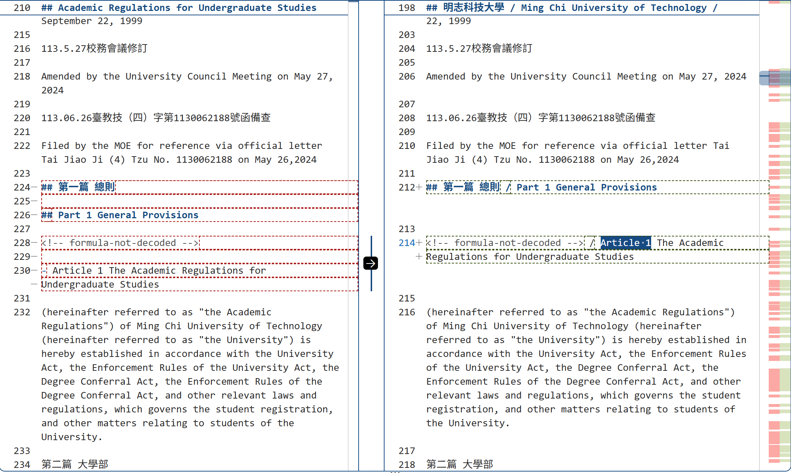
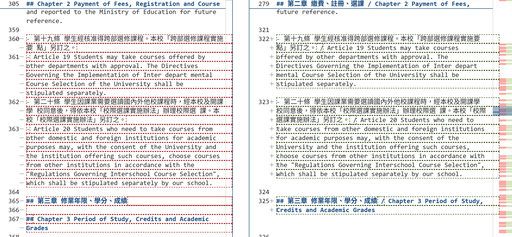
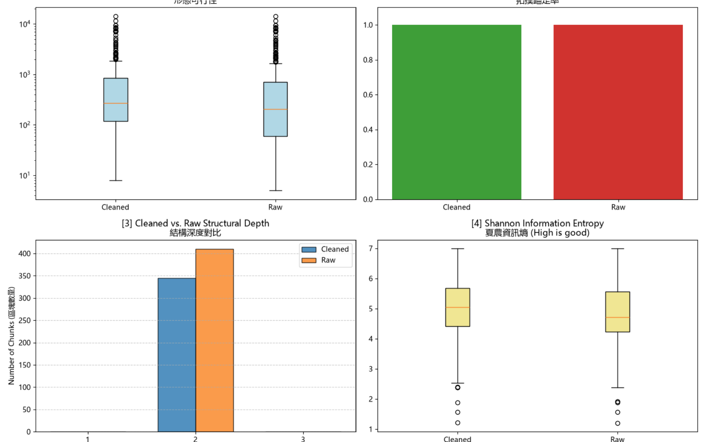

# 資料前處理報告 (Data Preparation Report)

> 期中評量 · NLP 自然語言處理 115-S1
> 填寫方式：請把所有「（ ）」與 `___` 替換成你自己的內容，並刪除 `>` 開頭的說明文字。

- **學號 / 姓名**：U12627007 / 江俞廷
- **專案名稱**：NLP 自然語言處理 (115 S1) - 課程專案
- **完成的任務**：- [x] 1-A 頁首頁尾清除　- [x] 1-B 雙語標題合併　- [x] 1-C 雙語條文合併

---

## 1. 資料集概覽 (Dataset Overview)

> 數字來源：`01_Data_Ingestion.ipynb` 第 2 節 (掃描 PDF) 與第 5 節 (批次處理) 的輸出。

| 類別 (Cluster) | PDF 數量 | 清洗前 chunk 數 | 清洗後 chunk 數 |
|---|---|---|---|
| Academic_Affairs | 3 | 96 | 65 |
| Library_Information | 3 | 248 | 225 |
| Student_Affairs | 3 | 66 | 55 |
| **合計** | **9** | **410** | **345** |

**問題 (2–3 句)：** 清洗後 chunk 數量變少了多少？是哪個任務造成的？有沒有哪個任務**不影響** chunk 數量？為什麼？

清洗後 chunk 從 410 個減少到 345 個，少了 65 個（約 15.9%），其中以《大學部學則》最明顯（43 → 21）。因為切塊規則 `\n(?=##\s)` 只在 `## ` 標題處切開，減少主要來自任務 1-B 與 1-C：原本中文標題（如「## 第一條」）和英文標題（如「## Article 1」）各自是一個 `##` 標題、各自成為一個 chunk，合併後標題數變少，chunk 數也跟著變少。任務 1-A 不影響 chunk 數量，因為它只刪除段落中的頁首頁尾文字，沒有新增或刪除 `## ` 標題，所以切塊的位置不會改變。

## 2. 清洗步驟 (Cleaning Steps)

> **截圖來源：** `data/interim/<類別>/` 中的 `raw_*.md` (清洗前) 與 `cleaned_*.md` (清洗後)，也就是批次處理存下的**真實檔案**。
>
> **[重要] 不可使用 notebook 中的範例。** notebook 任務 1-A、1-B、1-C 的測試文字 (第二十一條、明志科技大學 / Ming Chi University of Technology、第十五條 / Article 15) **不能**作為你的截圖。請在真實檔案中**另找一處**，可以是其他 PDF 的檔案。使用範例的截圖**不給分**。
>
> **截圖方法 (VS Code 比較檢視)：**
> 1. 在檔案總管對 `raw_<檔名>.md` 按右鍵 → **Select for Compare**。
> 2. 對同一份文件的 `cleaned_<檔名>.md` 按右鍵 → **Compare with Selected**。
> 3. 左右並排顯示，紅色 = 刪除，綠色 = 新增或修改。按 `Ctrl + F` 搜尋，找到該任務造成的變更。
> 4. 每個任務截**一張**圖，存到 `reports/figures/`，**檔名必須完全相同** (否則圖片不會顯示)：
>    * 任務 1-A → `1a_compare.png`
>    * 任務 1-B → `1b_compare.png`
>    * 任務 1-C → `1c_compare.png`

### 2.1 任務 1-A：頁首頁尾溢出清除

- 檔名：___　搜尋的文字：___
- 截圖 (存為 `reports/figures/1a_compare.png`)：
- 改變了什麼：___
- 這對之後的問答檢索有什麼幫助：___
- 這個任務有沒有**改錯**的地方 (把不該改的也改了)？若有，寫出檔名與搜尋的文字；若沒有，寫「沒有發現」：___

### 2.2 任務 1-B：雙語標題合併

- 檔名：___　搜尋的文字：___
- 截圖 (存為 `reports/figures/1b_compare.png`)：
- 改變了什麼：___
- 這對之後的問答檢索有什麼幫助：___
- 這個任務有沒有**改錯**的地方 (把不該改的也改了)？若有，寫出檔名與搜尋的文字；若沒有，寫「沒有發現」：___

### 2.3 任務 1-C：雙語條文合併

- 檔名：___　搜尋的文字：___
- 截圖 (存為 `reports/figures/1c_compare.png`)：
- 改變了什麼：___
- 這對之後的問答檢索有什麼幫助：___
- 這個任務有沒有**改錯**的地方 (把不該改的也改了)？若有，寫出檔名與搜尋的文字；若沒有，寫「沒有發現」：___

## 3. 評估指標與 AI 解讀查證 (Metrics & Verifying the AI's Interpretation)

### 3.1 指標數據表

> 數字來源：專案根目錄的 `metrics.json`。[1]、[2] 必填；[3]、[4] 選填。
> 「參考值」由老師在課堂上公布 (完成全部任務的結果)。

| 指標 | Raw | Cleaned (你的) | Cleaned (參考值) |
|---|---|---|---|
| [1] 中位數長度 Median Length | 205.0 | 273.0 | |
| [2] 拓撲錨定率 TAR | 1.0 | 1.0 | |
| [3] 深度變異量 SDV (選填) | 0.0 | 0.0 | |
| [4] 中位數資訊熵 Entropy (選填) | 4.72 | 5.05 | |

> **儀表板截圖：** 你自己的 `01_Data_Ingestion.ipynb` **第 6 節**輸出的 4 拼圖儀表板 (第 8 週執行並保留的輸出)。截圖後存為 `reports/figures/dashboard.png`。第 3.2 節也會用到這張截圖。



你的 Cleaned 結果與參考值一致嗎？若一致，寫「一致」；若不一致，找出原因。（1 句）

___

### 3.2 AI 的解讀

> 把第 3.1 節的儀表板截圖 (`dashboard.png`) 交給 AI，請它解讀結果。將 AI 的回答**完整貼在這裡**，並註明使用的 AI 工具。

- 使用的 AI 工具：Claude (Anthropic)

```text
這是一份比較清洗前 (Raw) 與清洗後 (Cleaned) chunk 品質的 4 拼圖儀表板：

[1] Chunk 長度分布（對數刻度箱型圖）
清洗後的中位數長度約 273 字元，高於清洗前的約 205 字元，整個箱子也往上移。這表示清洗把原本被切得很碎的小 chunk 合併成較完整的段落，最可能的原因是雙語標題合併 (1-B) 讓中文標題與英文標題不再各自成為一個 chunk。不過兩邊在 10^3 以上都有大量離群值，最長接近 10^4 字元，代表仍有少數極長的 chunk 沒有被切開。

[2] 拓撲錨定率 TAR
Raw 和 Cleaned 都是 1.0，表示 100% 的 chunk 都以 Markdown 標題開頭，切塊都錨定在文件結構上。清洗沒有破壞結構完整性。

[3] 結構深度
所有 chunk 的標題深度都是第 2 層 (##)，沒有第 1 層或第 3 層，所以深度變異量 SDV 為 0。清洗後第 2 層的 chunk 數從約 410 個減少為約 345 個，減少的部分來自標題合併。

[4] 夏農資訊熵
清洗後的中位數熵約 5.05，高於清洗前的約 4.72，表示每個 chunk 的字元多樣性提高，重複的雜訊（如頁首頁尾）變少，資訊密度變高。兩邊在 1～2.5 之間都有低熵離群值，這些很可能是只有標題、或由表格符號組成的 chunk，對檢索幫助不大。

總結：清洗讓 chunk 變得更長、更完整、資訊密度更高，同時維持 100% 的結構錨定。主要剩下的問題是少數超長 chunk 和低熵 chunk，需要進一步處理。
```

### 3.3 你的查證 (至少兩點)

> 挑 AI 說得最肯定的兩句話，回到你的檔案或程式中找證據：它說的是真的嗎？

**查證 1**
- AI 的說法：「清洗後第 2 層的 chunk 數從約 410 個減少為約 345 個，減少的部分來自標題合併。」
- 我查了什麼 (哪個檔案、哪個 chunk、哪段程式)：在 `01_Data_Ingestion.ipynb` 新增一格程式，逐一讀取 `data/processed/` 中 9 份 `raw_*_processed.json` 與 `cleaned_*_processed.json`，計算每份的 chunk 數（見第 1 節表格）；另外 `09_midterm_chunks.ipynb` 也讀到 cleaned 共 345 個 chunk。再對照 `01_Data_Ingestion.ipynb` 的切塊規則 `\n(?=##\s)`。
- 結論：部分正確，因為數字正確（Raw 410、Cleaned 345，減少 65 個），而且切塊規則只在 `## ` 處切開，標題合併確實會讓 chunk 變少。但 AI 只看圖就把原因全歸給「標題合併 (1-B)」，儀表板本身並沒有顯示是哪個任務造成的；1-B 與 1-C 都可能減少 `## ` 標題，要分別關掉某個任務重跑，才能確定各自的貢獻。

**查證 2**
- AI 的說法：「清洗後的中位數熵約 5.05，高於清洗前的約 4.72，表示每個 chunk 的字元多樣性提高，重複的雜訊（如頁首頁尾）變少，資訊密度變高。兩邊在 1～2.5 之間都有低熵離群值，這些很可能是只有標題、或由表格符號組成的 chunk。」
- 我查了什麼：`metrics.json` 的 `Information_Median_Entropy`（Cleaned 5.054、Raw 4.720）；`09_midterm_chunks.ipynb` 的 `chunk_entropy()` 函式；以及第 3.4 節 (b) 被指定的低熵 chunk（`cleaned_A242060013_學生請假作業辦法.md` 第 79 行）。
- 結論：部分正確。數字正確；低熵離群值的推測也正確，我拿到的低熵 chunk（熵 2.83）就是一張目錄表格，內容大多是空白、`-`、`|`。但「熵提高＝雜訊變少、資訊密度變高」說得太肯定：`chunk_entropy()` 是用「字元頻率」計算，chunk 越長、出現的不同字元越多，熵本來就容易變高；而清洗後中位數長度也從 205 增加到 273，所以熵上升有一部分只是因為 chunk 變長，不一定代表內容品質真的變好。

### 3.4 實際證據：你被指定的 chunk

> 執行 `09_midterm_chunks.ipynb`：填入你的學號與老師在課堂上公布的 SEED，按 Run All。
> 每位同學拿到的 chunk 不同。請**連同驗證碼**一起填入。
> 程式只顯示前 400 字元的預覽。請在 VS Code 打開程式列出的**閱讀用檔案** (`data/interim/` 中的 `cleaned_*.md`，與 JSON 內容相同但有正常換行)，按 `Ctrl + G` 輸入程式給的**行號** (或按 `Ctrl + F` 搜尋「搜尋用」文字)，從該行讀到下一個 `## ` 標題為止，就是**完整**的 chunk。

- **SEED**：1106

**(a) 很長的 chunk**
- 資料檔 (JSON)：`data/processed/Student_Affairs/cleaned_A242030012_學生獎懲規定_processed.json`　位置：第 1 個 (從 0 開始數)　長度：4828 字元　驗證碼：80241ff2
- 閱讀用檔案 (`.md`)：`data/interim/Student_Affairs/cleaned_A242030012_學生獎懲規定.md`　從第 51 行開始
- 前 3 行內容：
  ```text
  ## 108.12.12 臺教學(二)字第 1080177185 號函備查

  Approved for recordation by Letter Tai-Jao-Xue-(II) No. 1080177185 dated 2019.12.12
  ```
- 這是什麼樣的文字？為什麼會這麼長？這是《學生獎懲規定》開頭的「修訂沿革」（歷次校務會議修訂日期、教育部備查函號，中英對照），後面接著一個列出各條文標題的目錄表格（如「第二條 適用對象 / Article 2 Applicability」）。切塊規則只在 `## ` 標題處切開，而 Docling 只把第一行備查函號辨識成 `##` 標題，後面的修訂紀錄和整張目錄表格都沒有 `## ` 標題，所以全部被併進同一個 chunk，長達 4828 字元。
- 之後做問答檢索時，這麼長的 chunk 可能造成什麼問題？這個 chunk 混合了修訂日期、函號和目錄表格，主題很雜，轉成向量後語意被稀釋，問「某條文規定什麼」時可能誤把這個只有目錄、沒有內文的 chunk 檢索出來；而且太長可能超過 embedding 模型的長度上限被截斷，放進 LLM 時也會佔用大量 context。

**(b) 資訊熵很低的 chunk**
- 資料檔 (JSON)：`data/processed/Student_Affairs/cleaned_A242060013_學生請假作業辦法_processed.json`　位置：第 3 個 (從 0 開始數)　資訊熵：2.83　驗證碼：9a61c2b9
- 閱讀用檔案 (`.md`)：`data/interim/Student_Affairs/cleaned_A242060013_學生請假作業辦法.md`　從第 79 行開始
- 內容：
  ```text
  ## Table of Contents

  |           |                                                 |   頁次 |
  |-----------|-------------------------------------------------|--------|
  | 第一條    | 目的                                            |      1 |
  | Article 1 | Objective/Purpose                               |        |
  | 第二條    | 適用對象                                        |      1 |
  | Article 2 | Applicability                                   |        |
  | 第三條    | 請假方式                                        |      1 |
  | Article 3 | Method of Application                           |        |
  | 第四條    | 假別                                            |      2 |
  | Article 4 | Types of Leave                                  |        |
  | 第五條    | 請假規定                                        |      6 |
  | Article 5 | Regulations for Leave Application               |        |
  | 第六條    | 請假核決權責                                    |      7 |
  | Article 6 | Responsibility and Authority for Leave Approval |        |
  | 第七條    | 實施與修訂                                      |      8 |
  | Article 7 | Implementation and Amendment                    |        |
  ```
- 為什麼它的資訊熵這麼低？它對問答檢索有用嗎？這個 chunk 是《學生請假作業辦法》的目錄（Table of Contents），被 Docling 轉成 Markdown 表格。資訊熵是用「字元」出現頻率計算的，而表格為了對齊欄位，塞了大量重複的空白、`-` 和 `|`，這幾個字元佔了大部分內容，分布非常集中，所以熵只有 2.83。它對問答檢索幾乎沒有用：只有條號、條文標題和頁次，沒有任何實際規定內容，問「請假要怎麼申請」時可能被檢索出來卻答不出東西，反而擠掉真正有用的條文 chunk。可以在清洗時刪除目錄區塊，或在入庫前過濾掉熵太低的 chunk。

## 4. 一個尚未解決的問題 (One Remaining Problem)

> 打開 `data/interim/` 中任一個 `cleaned_*.md` (與 `data/processed/` 的 JSON 內容相同，但有正常換行，比較好讀)，找出一個清洗後**仍然有問題**的 chunk。
> 每個 chunk 從一個 `## ` 標題開始，到下一個 `## ` 標題之前結束。
> 例如：只有標題沒有內文、表格亂掉、中英文沒有對齊、還有殘留的頁首頁尾、斷行造成的多餘空白，或是**清洗造成的錯誤** (誤合併、誤刪除)。
> **不可**使用第 3.4 節的兩個 chunk。

- **檔名** (`cleaned_*.md`)：___　**從第 ___ 行開始** (VS Code 左側的行號)　**標題**：___
- **我是怎麼找到的** (例如：搜尋了什麼、看了哪個檔案)：___
- **問題 chunk (貼上部分內容)**：

```text
（貼上）
```

- **問題是什麼**：___
- **可能的原因** (PDF 本身？Docling 轉換？清洗的正則表示式？切塊規則？)：___
- **具體的修正方法** (例如：一條規則、一個正則表示式的構想、長度上限)：___
- **對問答檢索的影響**：___

## 5. AI 協作 (AI Collaboration)

- 本次作業的 AI 協作紀錄請見 [`AI_USAGE.md`](AI_USAGE.md) 的「Week 04 / 08」與「Week 09」段落。
- 這次使用 AI 最大的收穫或教訓是 ___（請具體：例如提示詞中哪一段最關鍵、AI 哪一句解讀不正確）
